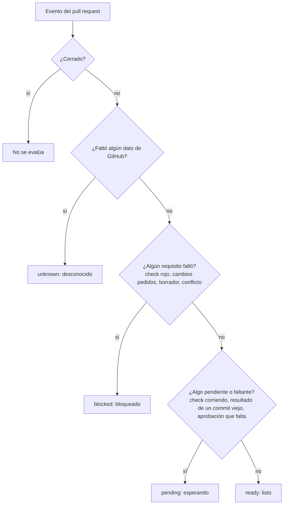
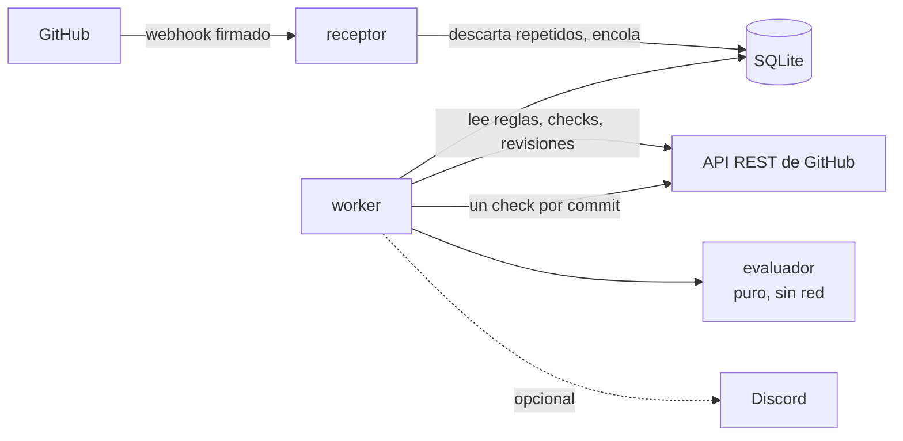

<div align="center">

<picture>
  <source media="(prefers-color-scheme: dark)" srcset="assets/logo-dark.svg">
  
</picture>

# PRotocol

**Saber por qué un pull request no se puede fusionar, y quién tiene que actuar.**

Una GitHub App de solo lectura que convierte las reglas de la rama, los checks y las
revisiones en un único veredicto claro, incluidos los checks verdes que dejaron de contar sin
avisar.

[](https://github.com/bbenedev/PRotocol/actions/workflows/ci.yml)


[Por qué](#por-qué) · [Qué muestra](#qué-muestra) · [Cómo decide](#cómo-decide) · [Probarlo](#probarlo) · [Hoja de ruta](#hoja-de-ruta) · [Documentos de diseño](#documentos-de-diseño)

[English](README.md) · **Español**

</div>

---

> [!NOTE]
> **En desarrollo.** El evaluador (las reglas que producen el veredicto) está terminado y
> probado. Conectarlo con GitHub es el próximo hito. Nada de esto exige ni fusiona nada.

## Por qué

Un pull request sobre una rama protegida puede quedar bloqueado por checks requeridos,
revisiones requeridas, dueños del código (CODEOWNERS), la aprobación del último push, por ser
borrador o por tener conflictos. La caja de fusión de GitHub te dice *que* falta algo. No
siempre te dice:

- que un **check verde corrió sobre un commit anterior** y ya no cuenta,
- que un check con el nombre correcto **lo publicó otra app**,
- que una aprobación **se descartó por un push nuevo**,
- ni **quién** tiene que moverse: el autor, un revisor, la CI o quien mantiene el repo.

PRotocol lee lo que GitHub ya exige y lo explica en un solo check. Nunca duplica tus reglas y
nunca ejecuta tu código.

## Qué muestra

Un check por commit, que se actualiza en el lugar y nunca se duplica. Esta es la salida real
del evaluador para un pull request de ejemplo con un check que falla, uno que pasa y una
aprobación que falta (los links a cada registro están acortados acá):

> **Blocked: 1 failing** for commit `aaaaaaa` against `ccccccc`.
>
> | | Requirement | Who acts | Details |
> |---|---|---|---|
> | ❌ | Check "ci/test" | author | Finished with "failure" on the current commit. Open the log, fix it and push. [evidence](#) |
> | ⏳ | 1 approving review | reviewer | 0 of 1 approvals count. |
> | ✅ | Check "lint" | — | Passed on the current commit. |
>
> _PRotocol only reads. GitHub's branch rules decide whether the merge button works._

El texto del check está en inglés porque es lo que ve cualquier persona que use el repositorio.

## Cómo decide



Reglas que nunca rompe:

| Regla | Por qué |
|---|---|
| La evidencia faltante nunca cuenta como aprobada | Un check que nunca informó no es un check verde |
| Un resultado de otro commit nunca cuenta para el actual | Un verde viejo puede tapar una falla nueva |
| Un check requerido solo cuenta si lo publicó la app requerida | Cualquiera puede llamar `ci/test` a un estado |
| Un acceso de escritura desconocido nunca ayuda a llegar a `ready` | En GitHub tampoco cuenta la aprobación de alguien sin acceso |
| La configuración se lee de la rama base, nunca del pull request | Un pull request no puede cambiar las reglas con las que se lo juzga |
| El texto que viene del repositorio se escapa antes de mostrarlo | Nombres de checks y de usuarios podrían meter links, tablas o menciones |

<details>
<summary><b>Frescura: cuándo un check verde deja de contar</b></summary>

| Frescura | Qué significa | Efecto |
|---|---|---|
| `current` | Corrió sobre el commit actual y la base actual | Cuenta |
| `old-head` | Corrió sobre un commit anterior del pull request | No cuenta: espera una ejecución sobre el commit actual |
| `old-base` | Corrió contra una base que ya avanzó | Cuenta como en GitHub, y lo dice; no cuenta si la rama exige estar al día |
| `base-unknown` | El proveedor no dice contra qué base probó | Cuenta, y el resumen avisa que la base es desconocida |

</details>

<details>
<summary><b>Arquitectura</b></summary>



- **El evaluador es puro.** Recibe datos y devuelve un veredicto. Una prueba hace fallar el
  build si alguien le agrega un import de fuera de su carpeta.
- **Un proceso y un archivo SQLite.** Sin Redis ni Kubernetes: lo puede operar una persona.
- **Los webhooks solo avisan que algo cambió.** El worker vuelve a leer el estado actual, así
  que eventos repetidos o desordenados no pueden dar un veredicto equivocado.

</details>

## Probarlo

El evaluador corre con Node.js 22.18 o más nuevo, sin acceso a internet:

```bash
git clone https://github.com/bbenedev/PRotocol
cd PRotocol
npm install
npm run check    # revisión estricta de tipos + 51 pruebas
```

```text
# tests 51
# pass 51
# fail 0
```

Las únicas dependencias son `typescript` y `@types/node`, las dos solo para desarrollo.

## Hoja de ruta

| | Hito | Estado |
|---|---|---|
| 0 | Confirmar los permisos de GitHub con una app de prueba y guardar respuestas reales de la API | siguiente |
| 1 | Evaluador: checks, revisiones, dueños del código, frescura, veredicto, resumen | ✅ hecho |
| 2 | Leer reglas, checks y revisiones desde la API de GitHub | planeado |
| 3 | Receptor de webhooks con verificación de firma, descarte de repetidos y una cola que sobrevive reinicios | planeado |
| 4 | Publicar el check: primera versión usable | planeado |
| 5 | Bot de Discord opcional: `/protocol status` y cambios de veredicto | planeado |
| 6 | Imagen Docker, guía para colaborar, primera versión publicada | planeado |

Queda afuera a propósito: fusionar, fusión automática, colas de fusión, un lenguaje de
políticas propio, y que una IA decida algo. GitHub, [policy-bot](https://github.com/palantir/policy-bot)
y [Kodiak](https://github.com/chdsbd/kodiak) ya hacen bien todo eso.

## Documentos de diseño

La investigación y el diseño vinieron antes que el código:

| Documento | Contenido |
|---|---|
| [Validación](docs/01-validacion.md) | Herramientas existentes verificadas en sus repositorios y documentación, huecos, y por qué se recortó el alcance |
| [Producto](docs/02-producto.md) | Objetivos, lo que no es, requisitos, métricas de éxito |
| [Arquitectura](docs/03-arquitectura.md) | Reglas del veredicto, flujo de eventos, esquema de la base, seguridad |
| [Repositorio](docs/04-repositorio.md) | Estructura, herramientas y elección de licencia |
| [Plan](docs/05-plan.md) | Hitos, con la condición que da por terminado a cada uno |
| [Preparación](docs/06-preparacion.md) | Preguntas abiertas y decisiones pendientes |

## Licencia

[Apache-2.0](LICENSE)
