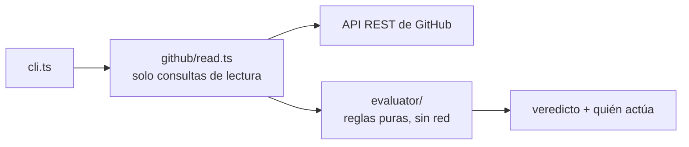

<div align="center">

<picture>
  <source media="(prefers-color-scheme: dark)" srcset="assets/logo-dark.svg">
  
</picture>

# PRotocol

**Saber por qué un pull request no se puede fusionar, y quién tiene que actuar.**

Le pasás cualquier pull request. Lee de GitHub las reglas de la rama, los checks y las
revisiones, y te dice en una pantalla qué falta, qué dejó de contar y a quién le toca moverse.

[](https://github.com/bbenedev/PRotocol/actions/workflows/ci.yml)


[Empezar](#empezar) · [Ejemplos](#ejemplos) · [Qué detecta](#qué-detecta) · [Usarlo en CI](#usarlo-en-ci) · [Cómo funciona](#cómo-funciona) · [Hoja de ruta](#hoja-de-ruta)

[English](README.md) · **Español**

</div>

---

## Empezar

```bash
git clone https://github.com/bbenedev/PRotocol
cd PRotocol
npm install
node src/cli.ts check palantir/policy-bot#1418
```

Necesita Node.js 22.18 o más nuevo. Acepta `dueño/repo#número` o el link del pull request, y
solo lee: nunca escribe en GitHub. Los repositorios públicos andan sin token; para los
privados, o para tener más consultas por hora, pasá el tuyo:

```bash
GITHUB_TOKEN=$(gh auth token) node src/cli.ts check https://github.com/dueño/repo/pull/123
```

## Ejemplos

Un pull request real de [palantir/policy-bot](https://github.com/palantir/policy-bot),
revisado el 21/10/2026 (el programa escribe en inglés):

```text
$ node src/cli.ts check palantir/policy-bot#1418
palantir/policy-bot#1418
WAITING  head 1e48c59  base e31b05e

… Check "policy-bot: develop"  → ci
  Not finished yet.
  https://policy-bot.general.dmz.palantir.tech/details/palantir/policy-bot/1418
… Check "docs/changelog"  → ci
  Not finished yet.
✔ Check "cla/palantir"
  Passed on the current commit. The provider does not say which base it tested against.
  https://cla.palantir.com/
✔ Check "ci-all"
  Passed on the current commit. The provider does not say which base it tested against.
  https://github.com/palantir/policy-bot/actions/runs/38951971089/job/117146409219

note: The base branch is protected. Review rules of classic branch protection are only visible to repository admins; if it uses them, they are not included.
note: 2 passing check(s) do not say which base they tested against.
```

Los cuatro checks son los que exige la rama `develop`. Dos terminaron y dos siguen esperando:
el pull request está **esperando a la CI**, y el autor todavía no tiene nada que hacer.

Cuando un check falla, la línea dice quién actúa y lleva al registro:

```text
✘ Check "ci/test"  → author
  Finished with "failure" on the current commit. Open the log, fix it and push.
  https://github.com/acme/app/actions/runs/1
```

Y cuando un resultado verde es de un push anterior, no cuenta:

```text
… Check "ci/test"  → ci
  The latest result is for commit bbbbbbb, not the current head aaaaaaa. Waiting for a run on the current commit.
```

<sub>Estos dos últimos bloques salen de las pruebas del proyecto, no de un repositorio real.</sub>

## Qué detecta

| Situación | Qué dice PRotocol |
|---|---|
| Un check requerido pasó, pero sobre un **commit anterior** | No cuenta; espera una ejecución sobre el commit actual |
| Un check con el nombre correcto, publicado por **otra app** | No cuenta, y nombra la app que lo publicó |
| Un check requerido que **nunca informó** | Falta, nunca verde; le avisa a quien mantiene que revise cuándo corre el workflow |
| Una aprobación **descartada** por un push nuevo, o de alguien **sin acceso de escritura** | No cuenta, y dice por qué |
| **Cambios pedidos** | Bloqueado, y quien actúa es el autor |
| Un **borrador** o un **conflicto** | Bloqueado, con qué hacer |
| Datos que GitHub **no muestra** (reglas que solo ve un administrador, dueños del código) | Lo dice, en vez de hacer como que está todo bien |

Cada punto pendiente dice **quién actúa**: el autor, un revisor, la CI o quien mantiene el repo.

## Usarlo en CI

El código de salida es el veredicto, así que un script puede esperar a un pull request o
fallar según el resultado:

| Código | Veredicto |
|---|---|
| `0` | listo |
| `1` | bloqueado |
| `2` | esperando |
| `3` | desconocido (GitHub no dio todo lo necesario) |
| `64` | error de uso |

`--json` imprime la evaluación completa, con cada requisito, su evidencia y sus links.

## Cómo funciona



- **Las reglas viven en un evaluador puro.** Recibe datos y devuelve un veredicto; una prueba
  hace fallar el build si alguien le agrega un import de fuera de su carpeta.
- **Lo desconocido nunca se vuelve verde.** La evidencia que falta, un acceso de escritura
  desconocido o reglas que no se pueden leer nunca ayudan a que un pull request parezca listo.
- **El texto de los repositorios no es confiable.** Los nombres de checks y de usuarios se
  limpian antes de llegar a tu terminal o al resumen de un check en GitHub.
- **Cero dependencias en ejecución.** Usa el `fetch` y el sistema de pruebas que trae Node.

```bash
npm run check    # revisión estricta de tipos + 60 pruebas, sin red
```

## Hoja de ruta

- [x] Evaluador: checks, revisiones, dueños del código, frescura, veredicto
- [x] Línea de comandos: revisar cualquier pull request desde la terminal
- [ ] GitHub App: el mismo veredicto como un check en cada pull request, actualizado en cada push
- [ ] Bot de Discord opcional para quien mantiene: `/protocol status` y cambios de veredicto
- [ ] Leer las reglas de dueños del código del repositorio

No está planeado: fusionar, fusión automática ni un lenguaje de políticas propio.
[policy-bot](https://github.com/palantir/policy-bot) y [Kodiak](https://github.com/chdsbd/kodiak)
ya lo hacen bien; PRotocol explica, no exige.

La investigación y las notas de diseño detrás de estas decisiones están en [`docs/`](docs/).

## Licencia

[Apache-2.0](LICENSE)
