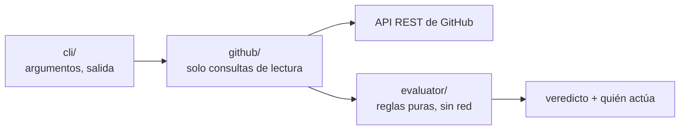

<div align="center">

<picture>
  <source media="(prefers-color-scheme: dark)" srcset="assets/logo-dark.svg">
  
</picture>

# PRotocol

**Saber por qué un pull request no se puede fusionar, y quién tiene que actuar.**

Una herramienta de consola que lee de GitHub las reglas de la rama, los checks y las
revisiones de un repositorio, y te dice en una pantalla qué falta, qué dejó de contar y a quién
le toca moverse.

[](https://github.com/bbenedev/PRotocol/actions/workflows/ci.yml)


[Instalar](#instalar) · [Uso](#uso) · [Ejemplos](#ejemplos) · [Qué detecta](#qué-detecta) · [Scripts y CI](#scripts-y-ci) · [Cómo funciona](#cómo-funciona)

[English](README.md) · **Español**

</div>

---

## Instalar

```bash
npm install -g https://github.com/bbenedev/PRotocol/archive/refs/heads/main.tar.gz
protocol --version
```

Necesita Node.js 22.18 o más nuevo. Los repositorios públicos andan sin token. Para los
privados, o para tener más consultas por hora, exportá uno (con la CLI de GitHub es una línea):

```bash
export GITHUB_TOKEN=$(gh auth token)
```

## Uso

```text
protocol check [<pull-request>]   revisa un pull request
protocol rules [<rama>]           muestra qué exige una rama antes de fusionar
protocol list                     todos los pull requests abiertos con su veredicto
```

Como `gh`, deduce el repositorio de la carpeta en la que estás:

```bash
cd mi-proyecto
protocol check 42          # el pull request 42 de este repositorio
protocol check             # el pull request de la rama en la que estás
protocol list              # todos los abiertos, y a quién le toca cada uno
```

O apuntalo a cualquier lado:

```bash
protocol check dueño/repo#42
protocol check https://github.com/dueño/repo/pull/42
protocol list -R dueño/repo
```

| Opción | |
|---|---|
| `-R, --repo dueño/repo` | usa este repositorio en vez del de la carpeta actual |
| `-j, --json` | salida para otros programas |
| `-q, --quiet` | no imprime nada; el código de salida es el veredicto |
| `-n, --limit N` | cuántos pull requests evalúa `list` (por defecto 10) |
| `--no-color` | salida sin colores (también con la variable `NO_COLOR`) |
| `-h, --help` · `-V, --version` | |

Solo lee. Nunca comenta, aprueba ni fusiona.

## Ejemplos

Todas estas salidas son reales, de [bbenedev/protocol-sandbox](https://github.com/bbenedev/protocol-sandbox),
un repositorio cuya rama `main` exige un check llamado `test`. Cada pull request muestra una
situación. El programa escribe en inglés.

**La vista de quien mantiene el repo:** todos los pull requests abiertos y a quién le toca.

```console
$ protocol list -R bbenedev/protocol-sandbox
#3      WAITING  ci                 Stale: green on an older commit
#4      BLOCKED  author             Draft: not ready for review
#2      BLOCKED  author             Failing: the required check is red
#1      READY    —                  Passing: the required check is green
```

**Un check que falla:** bloqueado, actúa el autor, y el link lleva al registro.

```console
$ protocol check -R bbenedev/protocol-sandbox 2
bbenedev/protocol-sandbox#2
BLOCKED  head 22d9fbe  base b5e9376

✘ Check "test"  → author
  Finished with "failure" on the current commit. Open the log, fix it and push.
  https://github.com/bbenedev/protocol-sandbox/actions/runs/39560551678/job/119090491439
```

**Un check verde que ya no cuenta:** pasó, pero en el commit anterior. El último push no tiene
resultado, así que el pull request no está listo, aunque en la página se vea una tilde verde.

```console
$ protocol check -R bbenedev/protocol-sandbox 3
bbenedev/protocol-sandbox#3
WAITING  head 8b4d2c5  base b5e9376

… Check "test"  → ci
  The latest result is for commit cb20422, not the current head 8b4d2c5. Waiting for a run on the current commit.
  https://github.com/bbenedev/protocol-sandbox/actions/runs/39560560886/job/119090521340
```

**Qué exige una rama:**

```console
$ protocol rules -R bbenedev/protocol-sandbox
bbenedev/protocol-sandbox: main

• check "test" from GitHub Actions
```

## Qué detecta

| Situación | Qué dice PRotocol |
|---|---|
| Un check requerido pasó, pero sobre un **commit anterior** | No cuenta; espera una ejecución sobre el commit actual |
| Un check con el nombre correcto, publicado por **otra app** | No cuenta, y nombra la app que lo publicó |
| Un check requerido que **nunca informó** | Falta, nunca verde; quien mantiene el repo debería revisar cuándo corre el workflow |
| Una aprobación **descartada** por un push nuevo, o de alguien **sin acceso de escritura** | No cuenta, y dice por qué |
| **Cambios pedidos** | Bloqueado; actúa el autor |
| Un **borrador** o un **conflicto** | Bloqueado, con qué hacer |
| Reglas que GitHub **no te muestra** (protección clásica sin ser administrador, dueños del código) | Lo dice, en vez de hacer como que está todo bien |

Cada punto pendiente dice **quién actúa**: el autor, un revisor, la CI o quien mantiene el repo.

## Scripts y CI

El código de salida de `protocol check` es el veredicto:

| Código | Veredicto |
|---|---|
| `0` | listo |
| `1` | bloqueado |
| `2` | esperando |
| `3` | desconocido, o no se pudo conectar con GitHub |
| `64` | error de uso |

```bash
protocol check -q 42 && echo "listo para fusionar"
protocol check --json 42 | jq '.results[] | select(.status != "met")'
```

## Cómo funciona



- **Las reglas viven en un evaluador puro.** Recibe datos y devuelve un veredicto. Una prueba
  hace fallar el build si alguien le agrega un import de fuera de su carpeta.
- **Lo desconocido nunca se vuelve verde.** La evidencia que falta, un acceso de escritura
  desconocido o reglas que no se pueden leer nunca ayudan a que un pull request parezca listo.
- **El texto de los repositorios no es confiable.** Los nombres de checks y de usuarios se
  limpian antes de llegar a tu terminal, para que no puedan mandarle secuencias de control.
- **Los cortes de red se reintentan** dos veces y después se informan en una línea, nunca con
  un volcado de error.
- **Cero dependencias en ejecución.** Usa el `fetch`, el lector de argumentos y el sistema de
  pruebas que trae Node.

### Desarrollo

```bash
git clone https://github.com/bbenedev/PRotocol && cd PRotocol
npm install
npm run check                     # revisión estricta de tipos + 81 pruebas, sin red
npm run build                     # compila a dist/ (la CI falla si dist/ quedó desactualizado)
node dist/cli/main.js --help
```

## Hoja de ruta

- [x] Evaluador: checks, revisiones, dueños del código, frescura, veredicto
- [x] Comando `protocol`: `check`, `rules`, `list`
- [ ] GitHub App: el mismo veredicto como un check en cada pull request, actualizado en cada push
- [ ] Bot de Discord opcional para quien mantiene el repo
- [ ] Leer las reglas de dueños del código del repositorio

No está planeado: fusionar, fusión automática ni un lenguaje de políticas propio.
[policy-bot](https://github.com/palantir/policy-bot) y [Kodiak](https://github.com/chdsbd/kodiak)
ya lo hacen bien; PRotocol explica, no exige. La investigación y las notas de diseño detrás de
estas decisiones están en [`docs/`](docs/).

## Licencia

[Apache-2.0](LICENSE)
