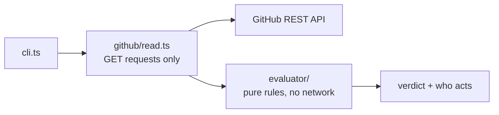

<div align="center">

<picture>
  <source media="(prefers-color-scheme: dark)" srcset="assets/logo-dark.svg">
  
</picture>

# PRotocol

**Know why a pull request can't be merged, and who has to act.**

Point it at any pull request. It reads the branch rules, checks and reviews from GitHub and
tells you, in one screen, what is missing, what stopped counting, and whose move it is.

[](https://github.com/bbenedev/PRotocol/actions/workflows/ci.yml)


[Quick start](#quick-start) · [Examples](#examples) · [What it catches](#what-it-catches) · [Use it in CI](#use-it-in-ci) · [How it works](#how-it-works) · [Roadmap](#roadmap)

**English** · [Español](README.es.md)

</div>

---

## Quick start

```bash
git clone https://github.com/bbenedev/PRotocol
cd PRotocol
npm install
node src/cli.ts check palantir/policy-bot#1418
```

Node.js 22.18 or newer. It accepts `owner/repo#number` or a pull request URL, and only reads:
it never writes to GitHub. Public repositories work without a token; for private ones, or a
higher rate limit, pass yours:

```bash
GITHUB_TOKEN=$(gh auth token) node src/cli.ts check https://github.com/owner/repo/pull/123
```

## Examples

A real pull request of [palantir/policy-bot](https://github.com/palantir/policy-bot), checked
on 21/10/2026:

```text
$ node src/cli.ts check palantir/policy-bot#1418
palantir/policy-bot#1418
WAITING  head 1e48c59  base e31b05e

… Check "policy-bot: develop"  → ci
  Not finished yet.
  https://policy-bot.general.dmz.palantir.tech/details/palantir/policy-bot/1418
… Check "docs/changelog"  → ci
  Not finished yet.
✔ Check "cla/palantir"
  Passed on the current commit. The provider does not say which base it tested against.
  https://cla.palantir.com/
✔ Check "ci-all"
  Passed on the current commit. The provider does not say which base it tested against.
  https://github.com/palantir/policy-bot/actions/runs/38951971089/job/117146409219

note: The base branch is protected. Review rules of classic branch protection are only visible to repository admins; if it uses them, they are not included.
note: 2 passing check(s) do not say which base they tested against.
```

The four checks are the ones the `develop` branch requires. Two are done, two are still
waiting, so the pull request is **waiting on CI**, and nothing is on the author yet.

When a check fails, the line says who acts and links to the log:

```text
✘ Check "ci/test"  → author
  Finished with "failure" on the current commit. Open the log, fix it and push.
  https://github.com/acme/app/actions/runs/1
```

And when a green result belongs to an earlier push, it does not count:

```text
… Check "ci/test"  → ci
  The latest result is for commit bbbbbbb, not the current head aaaaaaa. Waiting for a run on the current commit.
```

<sub>The last two blocks come from the test suite, not from a live repository.</sub>

## What it catches

| Situation | What PRotocol says |
|---|---|
| A required check passed, but on an **older commit** | Does not count; waiting for a run on the current commit |
| A check with the right name, published by the **wrong app** | Does not count, and names the app that published it |
| A required check that **never reported** | Missing, never green; tells the maintainer to check the workflow triggers |
| An approval **dismissed** by a new push, or from someone **without write access** | Does not count, and says why |
| **Changes requested** | Blocked, and the author is the one who acts |
| A **draft** or a **merge conflict** | Blocked, with what to do |
| Data GitHub **would not show** (rules visible only to admins, code owners) | Says so, instead of pretending everything is fine |

Every open item says **who acts**: the author, a reviewer, CI or a maintainer.

## Use it in CI

The exit code is the verdict, so a script can wait for a pull request or fail on it:

| Exit code | Verdict |
|---|---|
| `0` | ready |
| `1` | blocked |
| `2` | waiting |
| `3` | unknown (GitHub could not give everything needed) |
| `64` | usage error |

`--json` prints the full evaluation, with every requirement, its evidence and its links.

## How it works



- **The rules live in a pure evaluator.** It receives data and returns a verdict; a test fails
  the build if anyone makes it import anything outside its own folder.
- **Unknown never becomes green.** Missing evidence, unknown write access or rules it cannot
  read never help a pull request look ready.
- **Text from repositories is untrusted.** Check names and logins are cleaned before they reach
  your terminal or a check summary on GitHub.
- **Zero runtime dependencies.** It uses Node's own `fetch` and test runner.

```bash
npm run check    # strict type check + 60 tests, no network needed
```

## Roadmap

- [x] Evaluator: checks, reviews, code owners, freshness, verdict
- [x] Command line: check any pull request from the terminal
- [ ] GitHub App: the same verdict as a check on every pull request, updated on each push
- [ ] Optional Discord bot for maintainers: `/protocol status` and verdict changes
- [ ] Code owner rules read from the repository

Not planned: merging, auto-merge or a policy language of its own.
[policy-bot](https://github.com/palantir/policy-bot) and [Kodiak](https://github.com/chdsbd/kodiak)
already do those well; PRotocol explains, it does not enforce.

The research and design notes behind these decisions are in [`docs/`](docs/) (in Spanish).

## License

[Apache-2.0](LICENSE)
