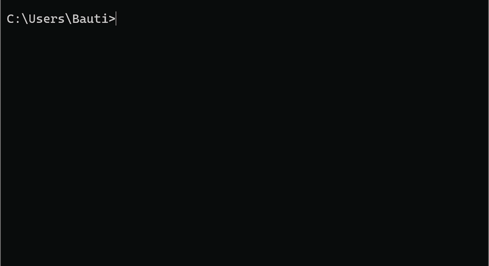
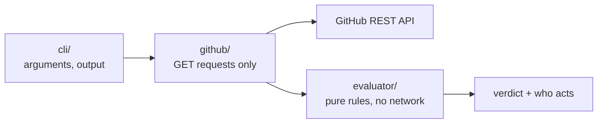

<div align="center">

<picture>
  <source media="(prefers-color-scheme: dark)" srcset="assets/logo-dark.svg">
  
</picture>

# PRotocol

**Know why a pull request can't be merged, and who has to act.**

A command line tool that reads a repository's branch rules, checks and reviews from GitHub
and tells you, in one screen, what is missing, what stopped counting, and whose move it is.

[](https://github.com/bbenedev/PRotocol/actions/workflows/ci.yml)


[Install](#install) · [Usage](#usage) · [Examples](#examples) · [What it catches](#what-it-catches) · [Scripts and CI](#scripts-and-ci) · [How it works](#how-it-works)

**English** · [Español](README.es.md)

</div>

<p align="center"></p>

---

## Install

```bash
npm install -g https://github.com/bbenedev/PRotocol/archive/refs/heads/main.tar.gz
prot --version
```

This installs the command under two names: `prot` and `protocol`. They are the same program.
Requires Node.js 22.18 or newer.

**Authentication.** If you are logged in with the [GitHub CLI](https://cli.github.com)
(`gh auth login`), there is nothing to set up: `prot` uses that session. Otherwise it reads
`GITHUB_TOKEN` or `GH_TOKEN`. With none of them it still works on public repositories, limited
to 60 requests per hour.

## Usage

```text
prot check [<pull-request>]   evaluate one pull request
prot rules [<branch>]         show what a branch requires before merging
prot list                     every open pull request with its verdict
prot list --me                only the pull requests waiting on you
prot check --watch            wait until CI finishes, printing each change
```

Like `gh`, it works out the repository from the folder you are in:

```bash
cd my-project
prot check 42          # pull request 42 of this repository
prot check             # the pull request of the branch you are on
prot list              # all open pull requests, who has to act on each
```

Or point it anywhere:

```bash
prot check owner/repo#42
prot check https://github.com/owner/repo/pull/42
prot list -r owner/repo
```

| Option | |
|---|---|
| `-r, --repo owner/repo` | use this repository instead of the current folder's (`-R` also works, as in `gh`) |
| `-j, --json` | machine-readable output |
| `-q, --quiet` | print nothing; the exit code is the verdict |
| `-m, --markdown` | Markdown output, for a CI job summary or a comment |
| `-w, --watch` | `check`: look again until the verdict is no longer waiting; the exit code is the final verdict |
| `--interval S` | seconds between looks with `--watch` (default 30, minimum 5) |
| `--me` | `list`: only pull requests where you have something to do |
| `-n, --limit N` | how many pull requests `list` evaluates (default 10) |
| `--no-color` | plain output (also when `NO_COLOR` is set) |
| `-h, --help` · `-V, --version` | |

It only reads. It never comments, approves or merges.

## Examples

All output below is real, from [bbenedev/protocol-sandbox](https://github.com/bbenedev/protocol-sandbox),
a repository whose `main` branch requires a check called `test`. Each of its pull requests
shows one situation.

**The maintainer's view:** every open pull request and whose move it is.

```console
$ prot list -r bbenedev/protocol-sandbox
#3  WAITING  ci      Stale: green on an older commit
#4  BLOCKED  author  Draft: not ready for review
#2  BLOCKED  author  Failing: the required check is red
#1  READY    —       Passing: the required check is green
```

**A failing check:** blocked, the author has to act, and the link goes to the log.

```console
$ prot check -r bbenedev/protocol-sandbox 2
bbenedev/protocol-sandbox#2
BLOCKED  head 22d9fbe  base b5e9376

✘ Check "test"  → author
  Finished with "failure" on the current commit. Open the log, fix it and push.
  https://github.com/bbenedev/protocol-sandbox/actions/runs/39560551678/job/119090491439
```

**A green check that no longer counts:** it passed, but on the previous commit. The latest
push has no result, so the pull request is not ready, even though a green tick is on the page.

```console
$ prot check -r bbenedev/protocol-sandbox 3
bbenedev/protocol-sandbox#3
WAITING  head 8b4d2c5  base b5e9376

… Check "test"  → ci
  The latest result is for commit cb20422, not the current head 8b4d2c5. Waiting for a run on the current commit.
  https://github.com/bbenedev/protocol-sandbox/actions/runs/39560560886/job/119090521340
```

**Waiting for CI:** `--watch` looks again every few seconds, prints only what changed, and
stops when the pull request is ready or blocked. Here a push has just been made:

```console
$ prot check -r bbenedev/protocol-sandbox 5 --watch --interval 5
bbenedev/protocol-sandbox#5
WAITING  head 93f49f5  base b5e9376

? Check "test"  → maintainer
  No result for this check has been reported on any commit of this pull request. Check that the workflow runs on pull requests and is not skipped by a path filter.

[21:04:37] bbenedev/protocol-sandbox#5
WAITING  head 93f49f5  base b5e9376

… Check "test"  → ci
  Not finished yet.
  https://github.com/bbenedev/protocol-sandbox/actions/runs/39697434060/job/119558134666

[21:04:43] bbenedev/protocol-sandbox#5
READY  head 93f49f5  base b5e9376

✔ Check "test"
  Passed on the current commit.
  https://github.com/bbenedev/protocol-sandbox/actions/runs/39697434060/job/119558134666
```

Chain it with anything: `prot check -w -q && notify-send "PR ready"`.

**Your turn:** `--me` keeps only the pull requests where you are the one who has to act, as
the author or as a requested reviewer.

```console
$ prot list -r bbenedev/protocol-sandbox --me
#4  BLOCKED  author  Draft: not ready for review
#2  BLOCKED  author  Failing: the required check is red
```

**What a branch requires:**

```console
$ prot rules -r bbenedev/protocol-sandbox
bbenedev/protocol-sandbox: main

• check "test" from GitHub Actions
```

## What it catches

| Situation | What PRotocol says |
|---|---|
| A required check passed, but on an **older commit** | Does not count; waiting for a run on the current commit |
| A check with the right name, published by the **wrong app** | Does not count, and names the app that published it |
| A required check that **never reported** | Missing, never green; the maintainer should check when the workflow runs |
| An approval **dismissed** by a new push, or from someone **without write access** | Does not count, and says why |
| **Changes requested** | Blocked; the author acts |
| A **draft** or a **merge conflict** | Blocked, with what to do |
| Rules GitHub **does not show you** (classic protection without admin rights, code owners) | Says so, instead of pretending everything is fine |

Every open item says **who acts**: the author, a reviewer, CI or a maintainer.

## Scripts and CI

The exit code of `prot check` is the verdict:

| Code | Verdict |
|---|---|
| `0` | ready |
| `1` | blocked |
| `2` | waiting |
| `3` | unknown, or GitHub could not be reached |
| `64` | usage error |

```bash
prot check -q 42 && echo "ready to merge"
prot check --json 42 | jq '.results[] | select(.status != "met")'
```

`--markdown` prints the same verdict as a table that GitHub renders, with repository text
escaped so a check name or a title cannot break the table or mention anyone. In a workflow it
can fill the job summary:

```yaml
- run: npm install -g https://github.com/bbenedev/PRotocol/archive/refs/tags/v0.5.0.tar.gz
- run: prot list -r "${{ github.repository }}" --markdown >> "$GITHUB_STEP_SUMMARY"
  env:
    GH_TOKEN: ${{ github.token }}
```

## How it works



- **The rules live in a pure evaluator.** It receives data and returns a verdict. A test fails
  the build if anyone makes it import anything outside its own folder.
- **Unknown never becomes green.** Missing evidence, unknown write access or rules it cannot
  read never help a pull request look ready.
- **Text from repositories is untrusted.** Check names and logins are cleaned before they reach
  your terminal, so they cannot send escape sequences.
- **Network failures are retried** twice and then reported in one line, never as a stack trace.
- **Zero runtime dependencies.** It uses Node's own `fetch`, argument parser and test runner.

### Develop

```bash
git clone https://github.com/bbenedev/PRotocol && cd PRotocol
npm install
npm run check                     # strict type check + 95 tests, no network needed
npm run build                     # compile to dist/ (CI fails if dist/ is out of date)
node dist/cli/main.js --help
```

## Roadmap

- [x] Evaluator: checks, reviews, code owners, freshness, verdict
- [x] `protocol` command: `check`, `rules`, `list`
- [x] `--watch`, `list --me` and Markdown output
- [ ] GitHub App: the same verdict as a check on every pull request, updated on each push
- [ ] Optional Discord bot for maintainers
- [ ] Code owner rules read from the repository

Not planned: merging, auto-merge or a policy language of its own.
[policy-bot](https://github.com/palantir/policy-bot) and [Kodiak](https://github.com/chdsbd/kodiak)
already do those well; PRotocol explains, it does not enforce. The research and design notes
behind these decisions are in [`docs/`](docs/) (in Spanish).

## License

[Apache-2.0](LICENSE)
