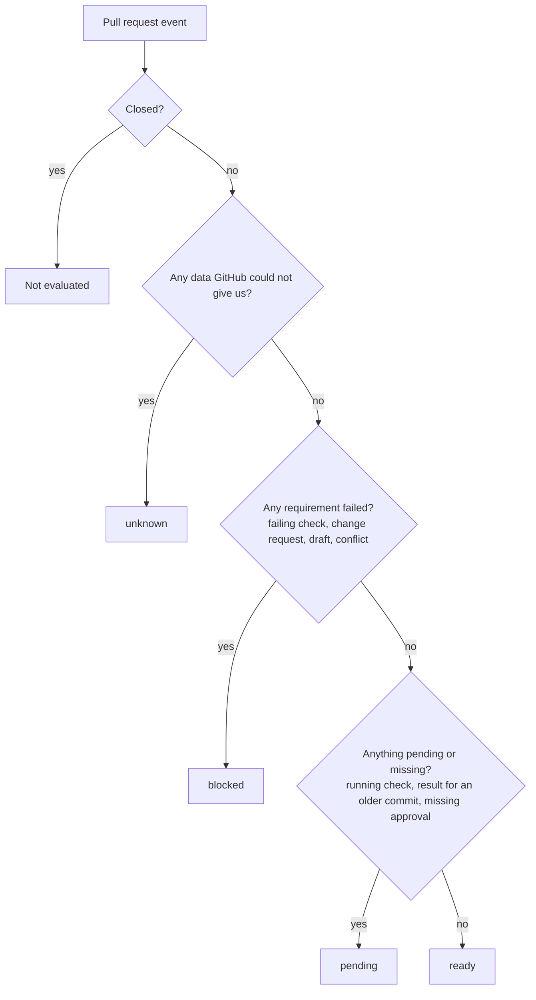
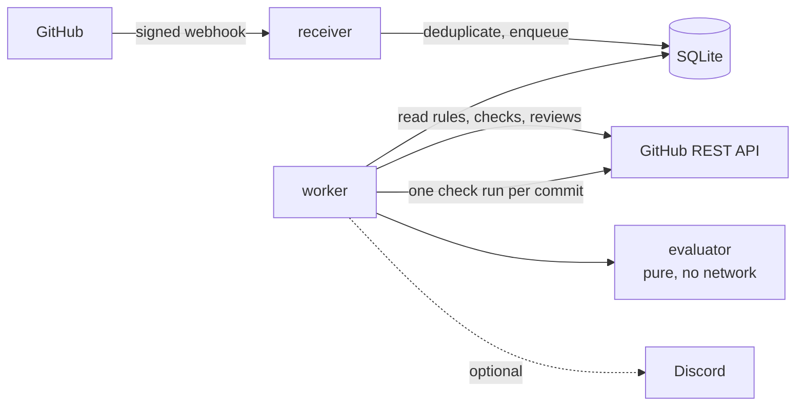

<div align="center">

<picture>
  <source media="(prefers-color-scheme: dark)" srcset="assets/logo-dark.svg">
  
</picture>

# PRotocol

**Know why a pull request can't be merged, and who has to act.**

A read-only GitHub App that turns branch rules, checks and reviews into one clear verdict,
including the green checks that silently stopped counting.

[](https://github.com/bbenedev/PRotocol/actions/workflows/ci.yml)


[Why](#why) · [What it shows](#what-it-shows) · [How it decides](#how-it-decides) · [Try it](#try-it) · [Roadmap](#roadmap) · [Design docs](#design-docs)

</div>

---

> [!NOTE]
> **Work in progress.** The evaluator (the rules that produce the verdict) is done and tested.
> Connecting it to GitHub is the next milestone. Nothing here enforces or merges anything.

## Why

A pull request on a protected branch can be blocked by required checks, required reviews,
code owners, approval of the latest push, drafts or conflicts. GitHub's merge box tells you
*that* something is missing. It does not always tell you:

- that a **green check ran on an older commit** and no longer counts,
- that a check with the right name was **published by the wrong app**,
- that an approval was **dismissed by a new push**,
- or **who** is supposed to move next: the author, a reviewer, CI or a maintainer.

PRotocol reads what GitHub already enforces and explains it in one check run. It never
duplicates your rules and never runs your code.

## What it shows

One check run per commit, updated in place, never duplicated. This is the evaluator's real
output for an example pull request with one failing check, one passing check and a missing
approval (the evidence links, which point to each run's log, are shortened here):

> **Blocked: 1 failing** for commit `aaaaaaa` against `ccccccc`.
>
> | | Requirement | Who acts | Details |
> |---|---|---|---|
> | ❌ | Check "ci/test" | author | Finished with "failure" on the current commit. Open the log, fix it and push. [evidence](#) |
> | ⏳ | 1 approving review | reviewer | 0 of 1 approvals count. |
> | ✅ | Check "lint" | — | Passed on the current commit. |
>
> _PRotocol only reads. GitHub's branch rules decide whether the merge button works._

## How it decides



Rules it never breaks:

| Rule | Why |
|---|---|
| Missing evidence is never treated as passing | A check that never reported is not a green check |
| A result for another commit never counts for the current one | Old green results hide new failures |
| A required check only counts if the required app published it | Anyone can name a status `ci/test` |
| Unknown write access never helps reach `ready` | An approval from someone without access does not count on GitHub either |
| Config is read from the base branch, never from the pull request | A pull request must not change the rules it is judged by |
| Text from repositories is escaped before it is shown | Check names and logins could inject links, tables or mentions |

<details>
<summary><b>Freshness: when a green check stops counting</b></summary>

| Freshness | Meaning | Effect |
|---|---|---|
| `current` | Ran on the current head commit and the current base | Counts |
| `old-head` | Ran on an earlier commit of the pull request | Does not count: waits for a run on the current commit |
| `old-base` | Ran against a base that has moved since | Counts like on GitHub, and says so; does not count when the branch requires being up to date |
| `base-unknown` | The provider does not say which base it tested | Counts, and the summary says the base is unknown |

</details>

<details>
<summary><b>Architecture</b></summary>



- **The evaluator is pure.** It receives data and returns a verdict. A test fails the build
  if anyone makes it import anything outside its own folder.
- **One process and one SQLite file.** No Redis, no Kubernetes: one person can run it.
- **Webhooks only say "something changed".** The worker re-reads the current state, so
  duplicate and out-of-order events cannot produce a wrong verdict.

</details>

## Try it

The evaluator runs with Node.js 22.18 or newer and no network access:

```bash
git clone https://github.com/bbenedev/PRotocol
cd PRotocol
npm install
npm run check    # strict type check + 51 tests
```

```text
# tests 51
# pass 51
# fail 0
```

The only dependencies are `typescript` and `@types/node`, both for development.

## Roadmap

| | Milestone | State |
|---|---|---|
| 0 | Confirm GitHub permissions with a test app and record real API responses | next |
| 1 | Evaluator: checks, reviews, code owners, freshness, verdict, summary | ✅ done |
| 2 | Read rulesets, checks and reviews from the GitHub API | planned |
| 3 | Webhook receiver with signature check, deduplication and a durable queue | planned |
| 4 | Publish the check run: first usable version | planned |
| 5 | Optional Discord bot: `/protocol status` and verdict changes | planned |
| 6 | Docker image, contribution guide, first release | planned |

Out of scope on purpose: merging, auto-merge, merge queues, a policy language of its own,
and AI deciding anything. GitHub, [policy-bot](https://github.com/palantir/policy-bot) and
[Kodiak](https://github.com/chdsbd/kodiak) already do those well.

## Design docs

The research and design came before the code. The documents are in Spanish:

| Document | Contents |
|---|---|
| [Validation](docs/01-validacion.md) | Existing tools checked against their repositories and docs, gaps, and why the scope was cut |
| [Product](docs/02-producto.md) | Goals, non-goals, requirements, success metrics |
| [Architecture](docs/03-arquitectura.md) | Verdict rules, event flow, database schema, security |
| [Repository](docs/04-repositorio.md) | Layout, tooling and licence choice |
| [Plan](docs/05-plan.md) | Milestones with the condition that ends each one |
| [Readiness](docs/06-preparacion.md) | Open questions and decisions still to make |

## License

[Apache-2.0](LICENSE)
