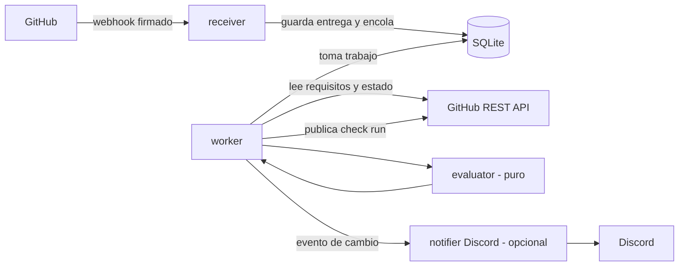
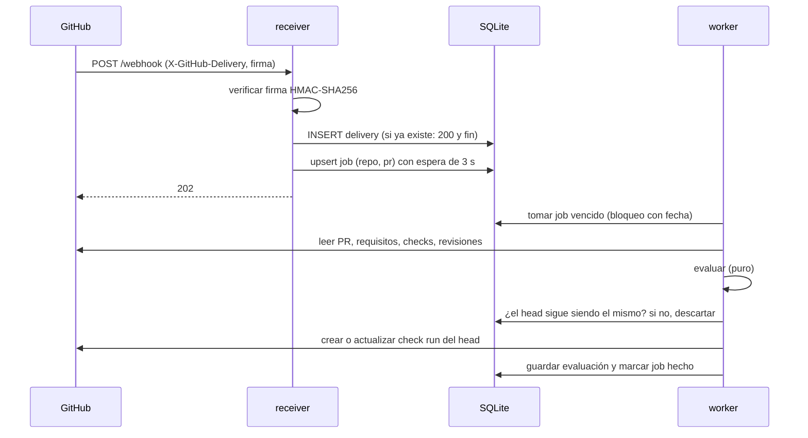
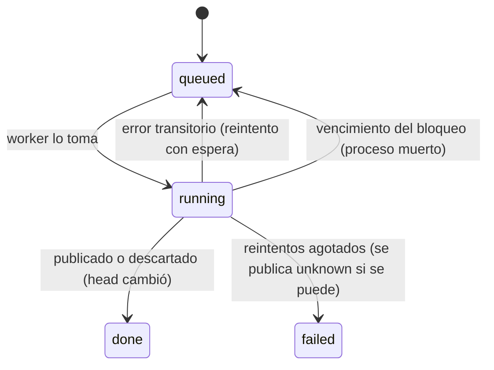

# C. Arquitectura

## Decisiones principales

| Decisión | Elegido | Por qué |
|---|---|---|
| Lenguaje | TypeScript sobre Node.js LTS | Lo pide el proyecto; Octokit y discord.js son de primera línea en Node. |
| Integración | GitHub App | Permisos por repo, tokens de instalación de corta vida, webhooks firmados. |
| Framework | `@octokit/app` + `@octokit/webhooks`, **sin** Probot | Probot agrega una capa que no hace falta para un solo tipo de check; se puede sumar después. |
| Forma | Un proceso (monolito modular) | Una persona lo puede operar; no hay carga que justifique servicios separados. |
| Estado | SQLite (modo WAL) | Cero instalación. Postgres solo si hace falta más de un proceso. |
| Cola | Tabla `jobs` en la misma base | Sobrevive a reinicios sin Redis. |
| Discord | discord.js, módulo opcional | El núcleo funciona sin Discord. |

## Componentes



Regla de dependencias: `evaluator` es puro y no importa nada que hable con la red. Solo
`github/` habla con GitHub y solo `discord/` con Discord. Lo verifica una prueba.

## Modelo de dominio (MVP)

```ts
type Verdict = "ready" | "blocked" | "pending" | "unknown";

interface PullRequestRef {
  repoId: number; owner: string; repo: string; number: number;
  headSha: string; baseRef: string; baseSha: string;
}

interface Requirement {          // lo que GitHub exige en la rama base
  id: string;                    // "check:ci/test", "review:approvals", "review:codeowners"
  kind: "check" | "review" | "codeowners" | "last-push-approval" | "mergeable" | "draft";
  source: "ruleset" | "branch-protection" | "derived";
  detail: Record<string, unknown>;
}

interface Evidence {             // por qué creemos lo que creemos
  kind: "check_run" | "commit_status" | "review" | "pr_field";
  externalId: string;            // id del check o de la revisión
  appSlug?: string;              // quién lo publicó
  commitSha: string;             // sobre qué commit
  baseSha?: string;              // contra qué base, si se sabe
  state: string;                 // tal como lo informa GitHub
  url?: string;
  observedAt: string;
}

type Freshness = "current" | "old-head" | "old-base" | "base-unknown";

interface RequirementResult {
  requirement: Requirement;
  status: "met" | "pending" | "failed" | "missing";
  freshness?: Freshness;
  evidence: Evidence[];
  actor: { kind: "author" | "reviewer" | "team" | "ci" | "maintainer"; who?: string };
  explanation: string;           // texto para personas
}

interface Evaluation {
  pr: PullRequestRef;
  configHash: string;            // hash de .github/protocol.yml de la base, o "none"
  requirementsHash: string;      // hash de los requisitos leídos
  verdict: Verdict;
  results: RequirementResult[];
  evaluatedAt: string;
}
```

Fuera del MVP: excepciones, auditoría de acciones administrativas (no hay acciones
administrativas), adaptadores externos y hallazgos de seguridad.

## Semántica del veredicto

Se evalúa en este orden y gana el primer caso que aplique:

1. PR cerrado → no se evalúa.
2. Algún dato necesario faltó o la API falló → `unknown` (nunca se adivina).
3. Algún requisito `failed` → `blocked`.
4. PR en borrador o con conflictos → `blocked`.
5. Algún requisito `missing` o `pending` → `pending`.
6. Algún check con frescura `old-head` → `pending` (hace falta el check del commit actual).
7. Un check con frescura `old-base` → `pending` solo si la regla exige la rama al día
   (`strict`); si no, cuenta como cumplido, igual que en GitHub, y la explicación lo dice.
8. Todo `met`, con frescura `current`, `old-base` (sin `strict`) o `base-unknown` → `ready`, y
   si hubo `base-unknown` se dice en las notas.

Otras reglas que sigue el evaluador (implementadas en el hito 1):

- Solo cuenta la última revisión de cada persona; los comentarios no cuentan; la del autor
  nunca cuenta.
- Una aprobación sin acceso de escritura confirmado no cuenta. Un pedido de cambios con
  acceso desconocido sí bloquea: lo desconocido nunca ayuda a llegar a `ready`.
- Un pedido de cambios solo bloquea si la rama exige revisiones, como en GitHub.
- `neutral` y `skipped` cuentan como aprobados, como en GitHub.

Reglas fijas:

- **La evidencia faltante nunca cuenta como cumplida.**
- Un check requerido con app esperada solo cuenta si lo publicó esa app.
- Un check de otro commit nunca cuenta para el `head` actual.
- `.github/protocol.yml` se lee de la rama base, nunca del PR: un PR no puede cambiar las
  reglas con las que se lo juzga.

## Frescura

- `old-head`: la evidencia es de un commit distinto del `head` actual.
- `old-base`: corrió contra una base que ya avanzó (solo cuando se sabe la base; por ejemplo,
  el evento `workflow_run` trae los SHA de cabeza y base del PR. **Por verificar** en pruebas
  de integración).
- `base-unknown`: el proveedor no dice contra qué base corrió. Se informa, no se oculta.

## Ciclo de un evento



Puntos de corrección:

- **Duplicados**: `deliveries.id` es la clave del encabezado `X-GitHub-Delivery`.
- **Desorden**: el worker no usa el contenido del webhook para decidir; relee el estado
  actual de GitHub. El webhook solo dice "algo cambió en este PR".
- **Ráfagas**: un solo job por PR; los eventos nuevos solo corren su hora de ejecución
  (espera de 3 s, a medir).
- **Un commit viejo no pisa uno nuevo**: antes de publicar se vuelve a leer el `head`; el check
  se publica con `head_sha` y GitHub lo asocia a ese commit.
- **Reinicios**: un job tomado tiene vencimiento; si el proceso muere, otro lo retoma.
- **Límites de la API**: se respetan `retry-after` y `x-ratelimit-reset`, con reintentos
  exponenciales y tope; agotados, el veredicto es `unknown`.
- **Cambio de configuración**: el `configHash` va en la evaluación; un push a la base que
  toca `.github/protocol.yml` encola todos los PR abiertos de esa base.

## Estados de un job



## Base de datos

```sql
CREATE TABLE deliveries (
  id TEXT PRIMARY KEY,            -- X-GitHub-Delivery
  event TEXT NOT NULL,
  received_at TEXT NOT NULL
);
CREATE TABLE jobs (
  repo_id INTEGER NOT NULL,
  pr_number INTEGER NOT NULL,
  run_after TEXT NOT NULL,
  attempts INTEGER NOT NULL DEFAULT 0,
  locked_until TEXT,
  state TEXT NOT NULL CHECK (state IN ('queued','running','done','failed')),
  PRIMARY KEY (repo_id, pr_number)
);
CREATE TABLE evaluations (
  id INTEGER PRIMARY KEY,
  repo_id INTEGER NOT NULL,
  pr_number INTEGER NOT NULL,
  head_sha TEXT NOT NULL,
  base_sha TEXT NOT NULL,
  config_hash TEXT NOT NULL,
  requirements_hash TEXT NOT NULL,
  verdict TEXT NOT NULL,
  result_json TEXT NOT NULL,
  check_run_id INTEGER,
  evaluated_at TEXT NOT NULL
);
CREATE INDEX evaluations_pr ON evaluations (repo_id, pr_number, evaluated_at);
CREATE TABLE notifications (      -- para no avisar dos veces lo mismo
  repo_id INTEGER NOT NULL,
  pr_number INTEGER NOT NULL,
  last_verdict TEXT NOT NULL,
  head_sha TEXT NOT NULL,
  PRIMARY KEY (repo_id, pr_number)
);
```

Retención: `deliveries` 7 días; `evaluations` 90 días (configurable); nada de código fuente.

## API HTTP

| Método | Ruta | Uso |
|---|---|---|
| POST | `/webhook` | Webhooks de GitHub. 401 si la firma no valida. |
| GET | `/healthz` | Vivo y con base accesible. |

No hay API de administración en el MVP.

## Interfaz de proveedores de evidencia

```ts
interface EvidenceProvider {
  name: string;
  collect(pr: PullRequestRef, signal: AbortSignal): Promise<Evidence[]>;
}
```

En el MVP hay dos implementaciones registradas en el código: check runs y estados de commit,
y revisiones. No hay carga dinámica de plugins.

## Seguridad

- **Permisos de la GitHub App**: Checks (escritura, solo para su check), Pull requests
  (lectura), Contents (lectura, para `.github/protocol.yml` y CODEOWNERS), Metadata (lectura).
  **Por verificar**: el permiso mínimo para leer las reglas efectivas de una rama
  (`GET /repos/{owner}/{repo}/rules/branches/{branch}`) y la protección clásica. Si exige
  administración, se ofrece como opcional y sin él el veredicto lo aclara.
- **Webhooks**: firma `X-Hub-Signature-256` comparada en tiempo constante, cuerpo crudo,
  límite de tamaño y rechazo de eventos de instalaciones desconocidas.
- **Secretos**: por variables de entorno o archivos montados; nunca en el repo ni en los
  registros. Rotación: la App admite dos claves privadas a la vez.
- **Datos no confiables**: títulos, descripciones, nombres de archivos y de checks se escapan
  antes de mostrarlos en Markdown o en Discord, y se recortan de largo.
- **Configuración maliciosa**: `.github/protocol.yml` se valida con un esquema, tiene tamaño
  máximo, no admite expresiones ni código y solo cambia textos y avisos.
- **No se ejecuta código del repo**, nunca.
- **Discord**: los comandos solo leen; los repos visibles en cada servidor de Discord se
  configuran del lado del que lo aloja, para no mostrar repos privados en un canal público.
- **Dependencias**: versiones fijadas con archivo de bloqueo, Dependabot y `npm audit` en CI.

## Despliegue

Imagen Docker única con un volumen para la base. Variables: `GITHUB_APP_ID`,
`GITHUB_PRIVATE_KEY_PATH`, `GITHUB_WEBHOOK_SECRET`, `DATABASE_PATH`, y opcionales
`DISCORD_TOKEN`, `DISCORD_CHANNEL_ID`. Para pruebas locales los webhooks se reciben con un
túnel (por ejemplo smee.io, **Por verificar** que siga disponible).

## Plan de pruebas

| Tipo | Ejemplos obligatorios |
|---|---|
| Unitarias (evaluador) | check verde de un SHA viejo → no cuenta; check requerido de otra app → no cuenta; evidencia faltante → `pending`, nunca `ready`; borrador → `blocked`; revisión con cambios pedidos y otra aprobada → según la regla de GitHub |
| Webhooks | firma inválida → 401; entrega repetida → un solo job; eventos desordenados → mismo resultado final |
| Worker | proceso muerto a mitad → el job se retoma; `head` cambió durante la evaluación → no se publica; límite de API → reintento y luego `unknown` |
| Configuración | archivo enorme, YAML inválido, campos desconocidos → se ignora con aviso y el veredicto no cambia |
| Discord | dos eventos con el mismo veredicto → un solo mensaje; texto con menciones `@everyone` en un título → escapado |
| Integración | contra un repo de prueba real con una App de prueba, con PR y checks escritos a mano |

Rendimiento: se definirá una carga (por ejemplo, N PR abiertos y M eventos por minuto) y un
script que la reproduzca antes de fijar metas de latencia.
